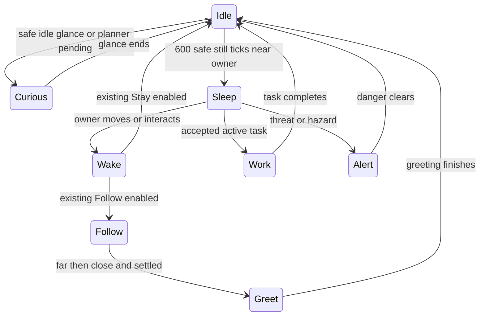
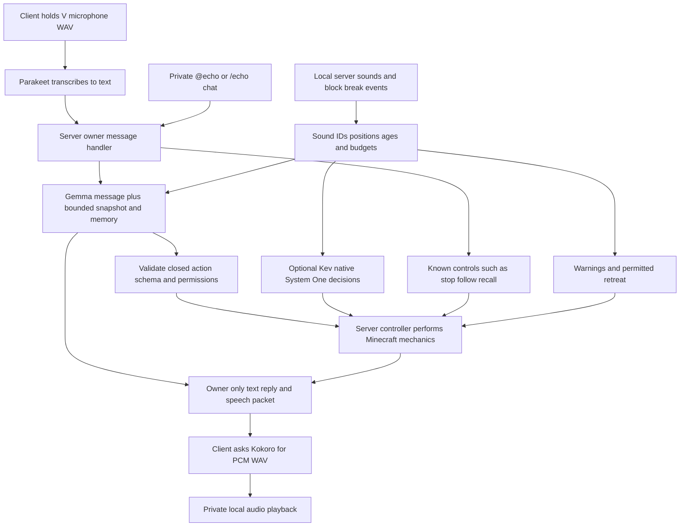

# Echo Minecraft companion guide

Echo 0.5.0 is a standalone Fabric mod for Minecraft Java 1.21.1. He is a visible, holdable white cube with two black eyes, a real inventory and server-controlled gameplay. Models are optional; no weights or inference runtimes have been installed for this delivery.

The paired [visual guide](../artifacts/echo-guide.html) explains the player experience. [README](../README.md) is the installation and configuration reference; [communication](../docs/COMMUNICATION.md) describes all input and output paths; [validation](../docs/VALIDATION.md) records test scope and remaining acceptance work.

## Appearance and ownership

The original entity model is one 10-pixel cube, 0.3125 blocks wide and tall, with black pill-shaped eyes and no mouth or limbs. Its face proportions follow the public [EchoFace reference](https://github.com/Ty0x7/EchoSpeak/blob/main/apps/web/src/components/EchoFace.tsx). The standalone mod contains its own assets and does not integrate with the EchoSpeak application. Verity JE supplied behavioral inspiration, without reused code or assets.

Automatic arrival checks for safe ground near the joining owner. Each player has one indexed companion per world save. Rejoining restores that identity; it does not unpack a deliberately carried cube. Normal disconnect parks the loaded entity state into the world ledger. Tasks restore paused.

Sneak-right-click or `/echo carry` stores the entity and gives a non-stackable cube item. Use it on supported, clear ground to restore the same UUID, health, inventory and memories. The world ledger holds canonical state; the item only holds a token, so copied items cannot duplicate the companion. Carried Echo currently has no active conversation or gameplay entity.

Sources: [entity](../src/main/java/dev/echo/entity/EchoEntity.java), [arrival](../src/main/java/dev/echo/world/EchoArrival.java), [world ledger](../src/main/java/dev/echo/world/CompanionLedger.java), [cube item](../src/main/java/dev/echo/item/EchoCubeItem.java), [entity model](../src/client/java/dev/echo/client/EchoCubeModel.java), [held model](../src/main/resources/assets/echo/models/item/cube.json), [editable Blockbench model](../models/echo-cube.bbmodel).

## Half size and connected idle behavior

Version 0.5.0 halves the physical width/height from 0.625 to 0.3125 blocks, halves the rendered entity and shadow, and changes the native held-item and Blockbench geometry from ten pixels to five. The first-person transforms tilt the face upward 18 degrees, turn it inward 35 degrees and raise the cube into view. Hand scale is 1.05 instead of 0.55; world size remains 0.3125 blocks. Resting geometry checks pass for both hands; final live visual acceptance remains pending. Existing companion identities, bags, permissions and memory are preserved.

The server selects a pose and tracks its world-tick start with `DataTracker`. Clients receive the state through normal entity synchronization; model transforms and the closed-eye texture use the same state/phase. The state machine itself performs no inference or additional world edits.

Sleep requires dry supported ground, nearby still owner, idle navigation and no queued work, planning or threat. It is interrupted by movement, interaction, tasks and danger. Explicit Pause remains paused and explicit Stay does not silently become Follow. Carried/stored entities have no running state machine, and pose timers are intentionally absent from persistent NBT.

The three extra animations are a reunion hop/wiggle after separation, a curious glance while idle or thinking, and rhythmic motion while stationary mining/crafting/placement. Walking retains a small gait bob, and threats take an alert pose. Hops are visual, so they do not change reach, collisions or material accounting.

Sources: [idle state machine](../src/main/java/dev/echo/entity/CompanionIdle.java), [entity synchronization and control](../src/main/java/dev/echo/entity/EchoEntity.java), [client poses](../src/client/java/dev/echo/client/EchoCubeModel.java), [held geometry](../src/main/resources/assets/echo/models/item/cube.json), [state tests](../src/test/java/dev/echo/ai/CompanionIdleTest.java).

## Communication architecture

### Player microphone

Enable `voiceEnabled` in the client configuration and configure a working Parakeet service. Hold V to capture at most 15 seconds of 16 kHz mono PCM WAV. Release to transcribe. The client sends audio to its configured service, then sends only the resulting bounded text to the Minecraft server. Typed and transcribed instructions share ownership validation and handling.

This is push-to-talk. There is no open microphone, wake word, desktop audio capture, speaker identification or integration with another voice-chat mod. The physical microphone may pick up background sounds.

### Minecraft hearing

Echo receives nearby server sound events and block-break effects as IDs, positions and ages. The default hearing radius cap is 32 blocks, configurable from 8 to 64, with a volume-based range estimate. Hearing is local to Echo, so he can hear something the distant owner cannot.

The buffer keeps at most 16 cues for 30 seconds, deduplicates nearby repetitions and accepts at most four cues per tick. Later planner and Kev requests include these cues. No inference call runs for each sound. Relevant priming and explosion cues can trigger rate-limited warnings; priming can briefly interrupt tasks for permitted retreat.

`/echo senses` and “what did you hear?” report the available cues without a model. This system does not reconstruct headphone audio, wall occlusion, resource-pack waveforms, client-only music or outside applications. A cue does not reveal a hidden entity as a visible target.

### Reply speech

The server replies only to the owner, with chat text and a speech text packet. If `speechEnabled` is on, that client asks Kokoro for PCM16 WAV and plays it through the system audio output. Playback gain follows Minecraft master and voice-category sliders. A newer reply or push-to-talk can interrupt playback. Failure leaves the text reply available.

This is a private radio-like companion channel. It works at a distance. It is not a positional Minecraft SoundManager source, and other nearby players do not hear the voice automatically.

### Distance and teleport requests

Use `@echo <message>` in ordinary chat or `/echo chat <message>`. Explicit @echo messages are privately routed and suppressed from ordinary multiplayer broadcast. Unrelated player chat is not sent to the models. The authoritative owner UUID resolves the same companion across dimensions and distance.

If the saved entity is unloaded, one message can wait up to ten seconds for an asynchronous lookup of its saved source chunk. Failure reports that no instruction ran. This is bounded reconnection, not permanent distant world simulation.

`/echo here`, “teleport to me”, “tp over to me”, and “Echo, teleport over to me!” request safe recall without model inference. The same cube is transferred or restored beside the owner after checking ground, collision and fluid conditions. Existing work is paused. Remote chat does not bypass world-edit permission, distance, loaded-chunk or dimension checks. A carried cube must be placed down first.

Sources: [message routing](../src/main/java/dev/echo/EchoCommunication.java), [packets](../src/main/java/dev/echo/net/EchoPackets.java), [voice capture and playback](../src/client/java/dev/echo/client/VoiceSupport.java), [hearing](../src/main/java/dev/echo/world/EchoHearing.java), [sound memory](../src/main/java/dev/echo/ai/SoundMemory.java), [sound hooks](../src/main/java/dev/echo/mixin/ServerWorldSoundMixin.java).

## Intelligence and action boundaries

| Component | Contract | Responsibility |
|---|---|---|
| Gemma 4 12B | Configurable OpenAI-compatible chat completion endpoint | Conversations and bounded sequential plans from observations and memory |
| Kev-4B | Native `POST /v1/systemone` | Optional engage, defend or retreat decisions with confidence gates |
| Parakeet | `POST /transcribe` with WAV, returns text JSON | Player speech recognition |
| Kokoro | `POST /speech` with text JSON, returns PCM WAV | Reply synthesis |
| Minecraft controller | Closed validated action types | Native navigation, breaking, crafting, placement, melee and inventory changes |

Gemma receives nearby blocks and mobs, biome, coordinates, weather and time, inventories, permissions, task state, memories and recent sounds. Whole responses validate before replacing a task. Pure conversation leaves ongoing work intact. No continuous autonomous replanning after failure is implemented.

Kev uses Jared Palmer’s [native System One API](https://github.com/jaredpalmer/kev), with `state`, a `choice` reaction question and a `noul` danger question. It has a separate worker queue and two-second deadline. Ownership, permissions and low-health retreat override its answer. Vanilla fallback continues when confidence is low or the endpoint fails. The server runtime chooses the Kev-4B checkpoint; the request model alias is configurable.

Plan output is data, not executable code. Counts, coordinates, item identifiers, response sizes and action types are bounded. The controller rechecks permissions and real materials on each action. Loopback HTTP is the default; remote endpoints require explicit opt-in and HTTPS. Credentials come from environment variables. Redirects are disabled; keys and response bodies are not logged. No action accepts shell execution or arbitrary Minecraft commands.

Sources: [brain](../src/main/java/dev/echo/ai/Brain.java), [planner backend](../src/main/java/dev/echo/ai/ModelBackend.java), [Kev backend](../src/main/java/dev/echo/ai/KevBackend.java), [HTTP bounds](../src/main/java/dev/echo/ai/BoundedHttp.java), [plan schema](../src/main/java/dev/echo/ai/Plan.java), [controller](../src/main/java/dev/echo/action/ActionController.java), [voice service](../backend/voice_service.py).

## In game setup and connection checks

Version 0.4.0 adds a native setup screen through the title/pause menu, F8 and `/echo-setup`. It separates Planner, Kev, Voice and World settings. Fields retain draft edits across tabs; Save page commits only the selected page. Done or Escape closes the screen without committing additional draft edits. Singleplayer server saves execute on the integrated server thread. Remote multiplayer users cannot edit server options through this screen.

The planner URL, exact model ID, environment variable names, enable flags, native Kev URL and alias, voice routes, independent microphone/speech flags, remote HTTPS permissions, automatic arrival, hearing radius and planner timeout are configurable. World changes do not grant per-companion edit permissions.

Connection and World options are instance/server-wide configuration. Companion inventories and memories remain specific to each world save. The native pages were visually inspected; Planner and Voice saves were checked against their generated JSON with all model/audio toggles off. Actual client captures are [Planner setup](../artifacts/media/echo-setup-planner.png) and [Voice setup](../artifacts/media/echo-setup-voice.png). Live inference and real headset validation remain separate work.

| Check | What it requests | What success establishes |
|---|---|---|
| Check model list | GET sibling `/v1/models`, preserving a proxy prefix | The configured planner alias is listed; no inference proof |
| Test reply inference | Synthetic chat completion, no world/player context | A bounded Echo JSON conversation response with no actions |
| Test System One inference | Native Kev synthetic threat-state request | Expected System One answer schema parses; no combat-quality proof |
| Parakeet or Kokoro health | GET sibling `/health` for the selected voice route | Process readiness and reported loaded flags; no audio/inference proof |

Diagnostics use a separate bounded worker queue, byte limits, deadlines and no redirects. They do not capture a microphone or execute returned actions. Inference checks are explicit; an external service may load/download weights on its own first inference. Health checks do not request inference. No model downloads or live inference were performed for this update.

Setup saves validate a whole candidate before replacing its JSON file using an atomic move where supported. Runtime configuration changes only after the write succeeds. Inference retains its original settings snapshot and its result is discarded if settings change. Voice option changes supersede old audio work. New credential environment values still require restarting the owning process.

Dedicated servers expose operator-only `/echo-config status`, `set <option> <value>`, `reload`, and `test models|planner|kev`, including console support. Settings save/apply immediately. Failed reload keeps runtime settings. Remote clients receive no server configuration editor or credential access. Native commands remain usable with all backends disabled.

For the player setup sequence and full command examples, see [Easier setup](../README.md#easier-setup-in-040). Planner/Kev endpoints are relative to the server machine; microphone/TTS endpoints are relative to each client. Loopback does not refer to a remote player's computer. Custom voice services without a compatible health route may fail the health check even when their inference route works; the message explains that distinction.

Sources: [native screen](../src/client/java/dev/echo/client/EchoSetupScreen.java), [connection checks](../src/main/java/dev/echo/setup/ConnectionChecks.java), [operator commands](../src/main/java/dev/echo/setup/SetupCommands.java), [configuration writes](../src/main/java/dev/echo/setup/ConfigFiles.java), [setup tests](../src/test/java/dev/echo/ai/SetupTest.java).

## Gameplay and setup

Install Java 21, Minecraft Java 1.21.1, Fabric Loader 0.16.14 or newer, and Fabric API 0.116.6+1.21.1. Put `dist/echo-minecraft-0.5.0.jar` in the instance’s `mods` directory. For multiplayer, both the server and each client need Echo and Fabric API. Back up the world before upgrading and remove an older Echo JAR.

Launch once to generate `config/echo-server.json` and `config/echo-client.json`. Join to trigger arrival. Models and voice are off by default. Use Save page or the operator reload command after editing configuration; new environment values still need a process restart. Follow README examples to configure inference endpoints and exact model aliases only when those separate services are available. Do not start the optional voice service until you intend to obtain its model weights.

| Goal | Control |
|---|---|
| Recall Echo | `/echo here` |
| Private conversation | `@echo Hello` or `/echo chat Hello` |
| Inspect hearing | `/echo senses` |
| Transfer held stack | `/echo give`, within four blocks |
| Permit mining or building | `/echo allow mine true`, `/echo allow build true` |
| Mine nearby exposed logs | `/echo mine minecraft:oak_log 3` |
| Craft three recipe batches | `/echo craft minecraft:oak_planks 3` |
| Build accessible small platform | `/echo platform minecraft:oak_planks ~2 ~ ~ 3 3` |
| Equip owned weapon | `/echo equip minecraft:iron_sword` |
| Interrupt or cancel | `/echo pause`, `/echo resume`, `/echo stop` |
| Inspect work or location | `/echo status`, `/echo locate` |
| Carry and place | Sneak-right-click; use cube item on safe ground |

Mining breaks real exposed blocks and applies tool, hardness, loot and durability rules. Crafting consumes real ingredients through ordinary shaped and shapeless recipes; larger recipes need a nearby crafting table. Construction consumes owned ordinary solid blocks. Combat uses native melee against hostiles targeting the owner or Echo, without targeting players or passive mobs.

Current limits include local exposed-block search, ground pathfinding, 32-step plans, small accessible builds and loaded terrain. There is no blueprint importer, recursive ingredient solver, furnace automation, container logistics, autonomous portal travel, navigation scaffolding, ranged combat or general survival planner. Claim-mod compatibility needs dedicated testing.

## Evidence and outstanding validation

The build and remapped JAR pass inspection. Twenty-two [Minecraft GameTests](../docs/test-results/minecraft-gametest.xml) passed against real headless server mechanics. Twenty-nine Java tests cover plan/protocol bounds, backend policy, mock HTTP, sound memory and seven setup/configuration checks. Six Python voice route tests passed with inference workers mocked. See [validation](../docs/VALIDATION.md) for exact cases and limitations.

The visual guide uses actual development-client screenshots under `artifacts/media/`: [world cube](../artifacts/media/echo-in-game.png) and [held cube](../artifacts/media/echo-held.png). Minecraft F2 saved both original PNGs in the disposable creative superflat test world. The generated [model preview](../models/echo-cube-preview.png) is a procedural design preview and is not gameplay evidence. The earlier world cube and inventory/third-person item textures were visibly confirmed; full animation and both-hand acceptance remain outstanding. Those captures predate the new hand transform. Version 0.5.0 increases first-person scale from 0.55 to 1.05, pitches the face up 18 degrees and turns it inward 35 degrees. Mathematical resting-pose checks cover both hands; this release has no new live in-game pose captures.

Still requiring acceptance: real Gemma/Kev inference and planning quality; Parakeet/Kokoro weights and synthesis/transcription; actual headset and device handling; multiple real players; production installation, protection mods, cold-chunk timeout behavior and sustained performance. No downloaded models or mocked responses are presented as live intelligence proof.

## Artifact validation record

The HTML is self-contained apart from relative project-local media. It uses inline CSS and accessible HTML diagrams, system fonts, responsive layouts and light/dark preferences. It makes no external runtime requests and contains no credentials. Technical source links remain in this document for follow-up work.

Rendered and visually inspected: desktop at 1440 pixels, mobile at 390 pixels, and desktop dark mode. Both images decoded, all HTML links resolved, no browser page errors occurred and the page width matched the viewport in all three checks. The evidence table has its own horizontal scroll container on narrow screens. Reproducible checks use `scripts/check_guide.cjs` with Playwright and an optional `ECHO_BROWSER_EXECUTABLE` environment setting; temporary render evidence stays under `build/guide-qa/`.

Client launch revealed missing held-item atlas entries. The new `assets/minecraft/atlases/blocks.json` registers the cube face and shell; resource reload confirmed the textures and removed the missing-texture warning. The mod was rebuilt successfully after the resource correction. Models and real audio remain untested and disabled.
