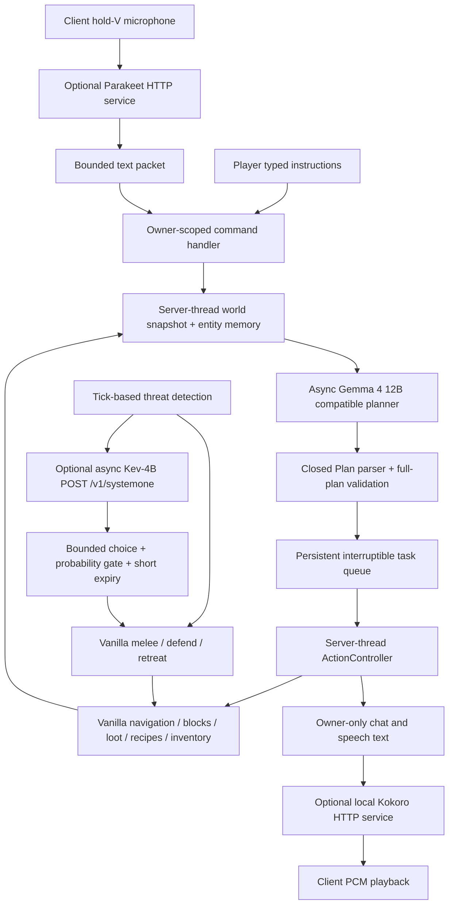
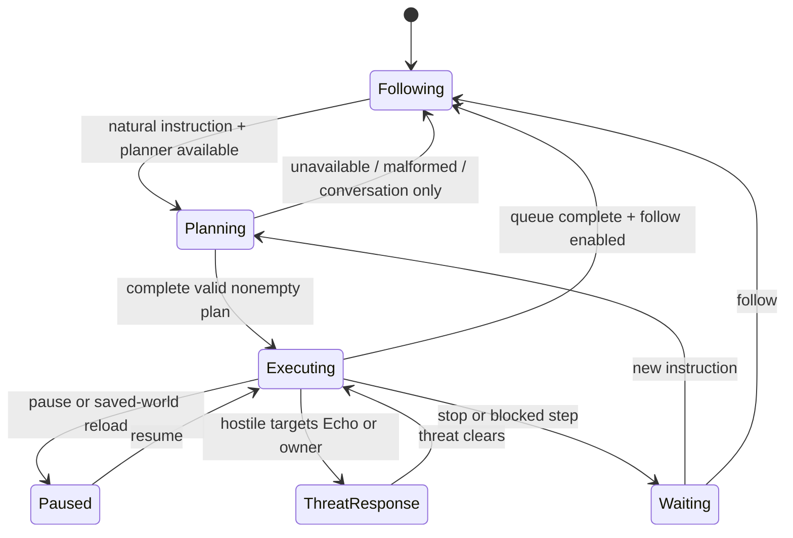

# Architecture

`EchoEntity` owns inventory, task queue, permissions, memory and fallback behavior. Its server tick runs native navigation, checks threats every ten ticks, and samples ordinary observations every sixty ticks. Explicit planner requests refresh observations on the server thread before immutable text goes to a worker. Workers never read or mutate the Minecraft world. Completion callbacks run on the server executor and check the request revision to discard cancelled/superseded plans.

`Plan` is the model trust boundary. It accepts bounded JSON and one of eight action types. `ActionController` validates owner proximity, dimension (through owner lookup), loaded chunks, modification rights, requested item/block types and per-companion permissions. It rechecks conditions during execution, uses vanilla mechanics and caps step duration at 2,400 active ticks. Combat interrupts work without removing queued steps; pause stops both task execution and combat behavior. Cancel invalidates outstanding model results.

The planner has two daemon workers and eight queued requests. Kev has a separate one-worker/four-request queue and a two-second HTTP deadline. Kev receives only a short combat snapshot, never the large conversation history. Model output is an advisory enum; melee targeting and safety rules stay authoritative. Client audio workers and their queue are also bounded. Backpressure produces explicit busy/fallback behavior.

World saves hold entity NBT and a world-scoped ownership ledger. No global user memory store is used. Save serialization reduces the active mining/crafting batch to its remaining count. A resumed task re-evaluates current world state. There is no exactly-once transaction across external crash-corrupted Minecraft saves; normal Minecraft save consistency applies.

The voice service is a separate, optional Python process chosen and started by the user. The Java mod never launches it or an inference runtime. Standard microphone/audio APIs and HTTP are the only client-side integrations. Models, keys and process supervision stay outside Minecraft gameplay logic.

In 0.2.0 the entity is a single white cube, with a matching native 3D item model. Sneak-interaction moves its full NBT to the world's ownership ledger and removes the live entity; the item contains only a UUID token. Deployment validates ownership and consumes canonical stored state once before allowing another live companion. Copied tokens cannot recreate an already deployed companion. Stored work is paused; world-specific tasks and remembered waypoints carry dimension provenance. The client renders blink textures and a small look/bob/tilt animation without humanoid geometry.

In 0.3.0, `EchoArrival` manages join retries, source anchors, persistent offline parking and explicit safe recall. `EchoCommunication` unifies private `@echo` chat, command text and transcribed microphone input, resolves ownership across dimensions and bounds unloaded-source reconnection to one queued message and a ten-second attempt. Explicit recall uses native Minecraft teleportation rather than a model-generated command. Arrival and reconnect queues run on the server tick and are cleared on disconnect/shutdown.

Lifecycle mixins and Fabric entity-load callbacks retain weak references to successfully admitted companions, because the vanilla UUID lookup can hide an entity in an inactive chunk. Resolution checks the authoritative owner index, server identity and removal state before using a reference. Unresolved or removed entities are never assumed safe to replace.

`ServerWorldSoundMixin` observes native positional/entity sound emission and block-break world effects. `EchoHearing` filters cues to the loaded companion's local range. `SoundMemory` deduplicates and bounds a thirty-second buffer that feeds later planner snapshots and Kev combat context. Rate-limited warnings and permitted short priming retreats work without model inference. This is semantic game-event awareness, not desktop audio capture or a reconstruction of the owner's audio output. See [communication guide](COMMUNICATION.md) for signal-flow diagrams and the voice/multiplayer behavior.
