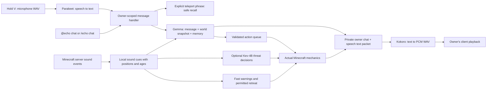

# How Echo hears, thinks, acts and speaks — 0.4.0

The models do not automatically know what Minecraft is doing. The mod gives them specific information. There are two separate input channels and one private speech output channel.



## Your microphone

Open Echo setup from the title/pause menu, F8 in game or `/echo-setup`. On the Voice page, configure a working Parakeet service, enable Mic and Save page. The equivalent setting is `voiceEnabled` in `config/echo-client.json`. Holding V opens the microphone, records at most 15 seconds and sends a 16 kHz mono WAV to the configured local service. Release V to send. Parakeet returns text, such as “Gather wood” or “Teleport to me.” Minecraft receives only that bounded text through an owner-scoped packet.

The server routes the text exactly like a typed instruction. Known stop/follow/teleport controls do not require model inference. Open-ended conversation and planning go to Gemma with observations and memory. No open microphone, wake word, desktop/system audio capture, voice-chat-mod integration or speaker identification is implemented. Microphone input can include any sound physically picked up by your microphone; it is not proof that a specific person spoke.

## Minecraft hearing

Echo's ears use the game's own event data. ServerWorld hooks observe positional and entity sound emissions, plus the block-break world effect. A zombie sound becomes a cue resembling:

```text
minecraft:entity.zombie.ambient at 120,64,-30 (2s ago)
```

Only cues within Echo's configured local radius are stored. Range is a volume-based estimate, capped by `hearingRadius` (default 32, configurable 8–64). Echo can hear local cues when his owner is far away or in another dimension, provided Echo's area is loaded and the server emits the sound. The owner need not hear that same sound.

The short-term buffer holds at most 16 cues for 30 seconds, deduplicates repeated nearby sounds and accepts at most four cues per tick. It is not a permanent raw sound recording. It enters later Gemma snapshots and optional Kev combat requests. No model runs for every footstep. Priming and explosion cues can produce rate-limited warnings; nearby creeper/TNT priming can interrupt work for a short retreat if Echo is unpaused and combat behavior is permitted.

Hearing a sound does not make a hidden entity visible. Cue IDs are not full waveform analysis or exact headphone audibility: player sound sliders, resource-pack samples, client-only effects/music, wall occlusion and outside applications are not reconstructed. `/echo senses` and “what did you hear?” expose the actual recent cues so awareness is reviewable.

## Echo's TTS

Echo first produces reply text. The server sends it only to the owning player, in chat and a bounded speech packet. If that player's `speechEnabled` setting is on, their client asks Kokoro to synthesize the text. The service returns PCM16 WAV, and the client plays it through the selected system audio output, scaling volume by Minecraft's master and voice-category settings.

This is a private companion voice connection. You can hear the reply while Echo is far away, like speaking over a radio. Other players do not receive the audio. The current implementation is not a positional Minecraft SoundManager emitter, and nearby players do not automatically hear him. Playback is interrupted/superseded when recording or receiving a newer reply. If Kokoro is unavailable, the chat reply still appears.

## Private long-distance chat and recall

Use normal chat with `@echo ` at the start, `/echo chat <message>`, or microphone input. Normal player chat is not indiscriminately forwarded to the models. Explicit `@echo` messages are routed to your companion and suppressed from ordinary multiplayer broadcast.

The server resolves your companion UUID across loaded dimensions, not by looking for a nearby entity. Chat has no distance limit. If the entity's chunk is unloaded, one message can wait up to ten seconds while the saved source chunk is requested asynchronously. Failure reports that no instruction ran; it never constructs a replacement with duplicated resources. This is a bounded reconnect attempt, not permanent whole-world simulation or a guarantee of terrain-independent background work.

`/echo here`, “teleport to me,” “tp over to me” and “Echo, teleport over to me!” explicitly request safe recall. Only the owner can recall his indexed cube. A nearby supported, unoccupied, non-fluid destination is checked before teleporting/restoring the same UUID. Inventory, memory and health survive, and existing tasks are paused. A deliberately carried cube remains carried; place it down yourself. The carried item currently has no active chat/voice entity behind it.

Remote conversation does not grant remote block-edit permissions or bypass loaded-chunk, owner-distance and dimension action checks. Echo can explain his situation from afar; a task that needs the owner nearby may require recall first.

## Joining and leaving

Automatic arrival is on by default. When you join, Echo gets a short safe-space retry window. A new player gets one new cube; a returning player gets the existing identity. On normal disconnect/shutdown, a loaded Echo is serialized into a world-persistent parked entry, then restored beside you on rejoin. Carried state is distinct from parked state and is never automatically unpacked. Older unloaded companions use their saved dimension/position anchor for a bounded lookup rather than being duplicated.

Set `autoSpawnOnJoin: false` to disable automatic arrival. Use `/echo here` to retry manually. No safe ground, missing origins, unexpected deletions and incomplete chunk activation fail explicitly. Actual network joins, slow disks, audio devices and real model latency still need manual acceptance testing beyond the headless tests.

## Model roles

| Component | Responsibility |
|---|---|
| Parakeet | Converts microphone audio into words; does not decide gameplay. |
| Gemma 4 12B | Interprets words, world state, recent sounds and memory; returns conversation and bounded plans. |
| Kev-4B | Optional native System One classification of immediate threat reactions; not a chat model. |
| Action controller | Rechecks permissions and executes real server-side Minecraft mechanics. |
| Kokoro | Converts reply text into speech; does not listen or plan. |
| Vanilla navigation/reflexes | Keeps movement, safety and basic behavior running while models are slow/offline. |

All model backends remain optional and separately configured. The setup screen's health checks do not run inference or record audio. Model-list checks do not prove planner JSON compatibility; explicit Test reply and native System One inference checks use synthetic context and execute no gameplay actions. An external service may load/download its configured weights on first inference; use these buttons only when ready. See the [setup sequence](../README.md#easier-setup-in-040).

No model weights or runtimes were downloaded for this implementation. A successful mod build is not live inference, microphone or headset validation.
